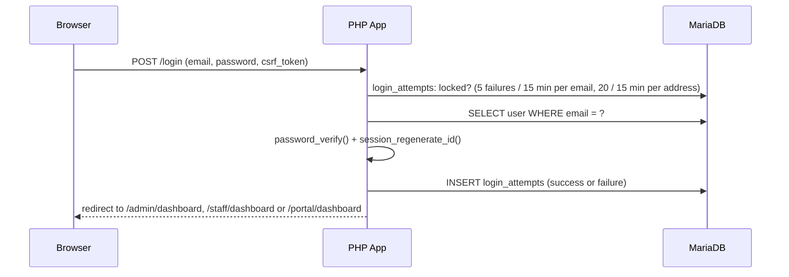
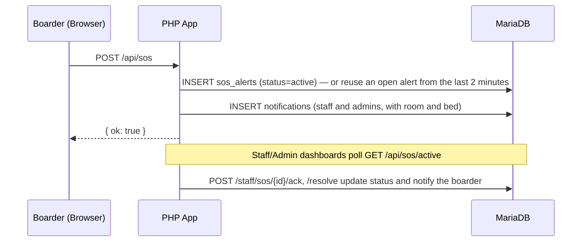
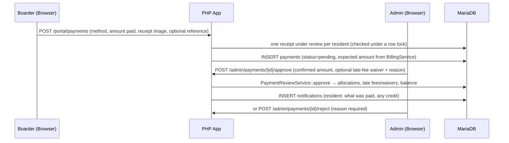
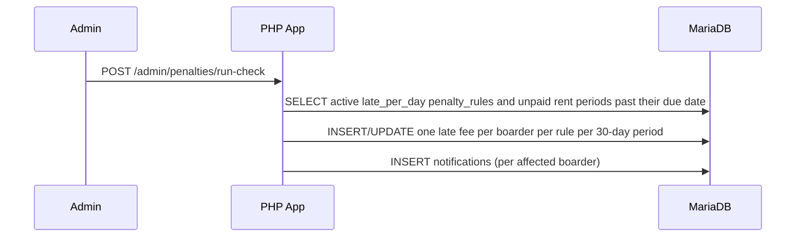
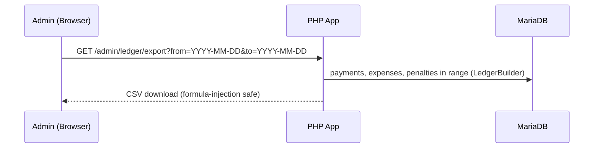
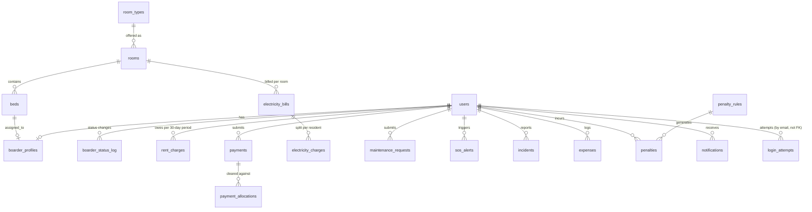

# RJM Boardinghouse — Architecture

Current design of the running system. Companion to `CLAUDE.md` (rules), `FEATURES.md` (what each feature should do) and `PROJECT_STRUCTURE.md` (where files live).

> **History:** the first version of this document (Sept 2026) specified a separate Python scoring service on `localhost:5000` and a PHP-to-Python connector contract. That service was removed in batch B6 (see `FINAL-REPORT.md`); repair scoring and payment checks are now plain PHP inside the app. The older text survives in git history (`git log -- ARCHITECTURE.md`) and in the historical reports (`PHASES.md`, `QA-VALIDATION-REPORT.md`, `DEBUGGING-REPORT.md`).
>
> Section numbers are kept stable because source comments cite them (§3.1, §4.2, §4.3, §4.5). If you change a design decision, edit it here in the same change.

---

## 1. Context View — who touches the system, and what's outside it

```
        ┌─────────────┐      ┌─────────────┐      ┌─────────────┐
        │    Admin    │      │    Staff    │      │   Boarder   │
        │   / Owner   │      │ (caretaker) │      │  / Resident │
        └──────┬──────┘      └──────┬──────┘      └──────┬──────┘
               └────────────────────┼────────────────────┘
                                    ▼
                    ┌───────────────────────────────┐
                    │   RJM Boardinghouse System     │
                    │   (single machine, localhost)  │
                    └───────────────────────────────┘
```

- **No external systems are called by the running app.** No payment gateway, SMS/e-mail provider, cloud storage or third-party AI API. Payments are made outside the system (GCash, Maya, bank transfer) and proven by an uploaded receipt that an admin checks.
- **One optional local helper:** [Ollama](https://ollama.com) on `localhost:11434` powers the AI helper buttons and free-text assistant chat (`src/Services/OllamaClient.php`). Everything works without it; the buttons then say "offline".
- **One permitted exposure:** the temporary Cloudflare quick tunnel the owner starts by hand with `start-online.bat` (`bin/go-online.ps1`). The app and database still run on this machine; the tunnel only forwards visitors to it. See `README.md` "Going online for a demo" and `src/Support/TrustedProxy.php`.
- **Planned, not built:** e-mail reminders through a queue that sends nothing until an admin enables SMTP (WP-9 in `../IMPLEMENTATION-PLAN-2026-10-14.md`); a CCTV/people-counter page (`CCTV-PEOPLE-COUNTER-PLAN.md`). Either is a scope change to confirm with the owner first.

---

## 2. Container View — three components

| # | Component | Tech | Runs at | Responsibility |
|---|---|---|---|---|
| 1 | **Browser client** | server-rendered HTML + Tailwind CSS + GSAP + small vanilla JS | user's machine | Renders UI, forms, client-side checks, polling for notifications and SOS alerts |
| 2 | **PHP web app** | PHP 8.2+, no framework, no Composer; `php -S 127.0.0.1:8000 -t public public/index.php` | `127.0.0.1:8000` (`:8010` for the online launcher) | **Single system of record.** Sessions, RBAC, all reads and writes, repair scoring, billing, penalties, ledger, assistant |
| 3 | **MariaDB / MySQL** | XAMPP's MariaDB | `127.0.0.1:3306` | Sole datastore. Only the PHP app writes to it |

Repair-priority scoring (`ScoringClient`) and the billing and payment rules (`BillingService`, `PaymentReviewService`, `PenaltyEngine`) are in-process PHP. There is no second writer, no second service, and nothing to fail "closed" over the network: a payment is simply never approved without an admin.

---

## 3. Connectors

### 3.1 Browser ⟷ PHP app
- Standard HTTP. After login the session cookie is `HttpOnly` and `SameSite=Strict`, and `Secure` when the request came over https (directly or through a trusted tunnel). Idle sessions end after 30 minutes; a password change, deactivation or role change ends other sessions.
- `public/index.php` is the single entry point and the route table (`$router->add(METHOD, PATH, handler)`, 86 routes). It also sets security headers (CSP, `X-Frame-Options: DENY`, …) and the global exception handler, which logs the real error and shows a generic page.
- Two request styles, used deliberately:
  - **Full page loads** (form POST + redirect with a flash message) for anything that changes state.
  - **Small JSON endpoints** where a page needs data without reloading: `GET /api/notifications/unread` (bell, polled), `POST /api/notifications/{id}/read`, `POST /api/sos`, `GET /api/sos/active` (staff dashboard poll), `POST /api/maintenance/score-preview`, and the assistant endpoints under `/api/assistant/*`.
- Every state-changing request carries the session CSRF token (`csrf_token`, `src/Support/Csrf.php`). The only exception is the public inquiry form `POST /inquire`, which has a honeypot field and an hourly per-address limit instead.
- Role guards: `AuthMiddleware::require()` then `RoleMiddleware::require([...])` at the top of each route handler.

### 3.2 PHP app ⟷ scoring and payment rules (in-process)
No network hop.

- **Repair priority:** `ScoringClient::score($description, $category, $hasMedia)` returns `{score, tier (critical|high|medium|low), matched_keywords, matches}`. Score = category base weight + whole-word keyword weights + a bonus for an attached photo/video. It is the only keyword list; the resident form's live preview calls the same code (`POST /api/maintenance/score-preview`). **Not implemented:** the time-decay in `FEATURES.md` §1 (open item F-18 / WP-11).
- **Payments:** every receipt is stored `pending`. The amount owed comes from the system, never the form; a differing claimed amount is only flagged (⚠) for the admin. An admin approves (typing the amount the receipt shows) or rejects (reason required). `PaymentReviewService::approve` credits the oldest unpaid rent first, then electricity, then penalties, and records the split in `payment_allocations`.
- **Never auto-approve** a payment for any reason. The statuses `auto-matched` and `flagged` exist only on rows from before the Oct 2026 rules.

### 3.3 PHP app ⟷ database
- PDO only, prepared statements only, no string-built SQL — a hard rule.
- One connection helper, `src/Database.php` (`Database::getConnection()`), used everywhere. Settings come from real environment variables first, then from the git-ignored `.env` for any that are unset (`DB_HOST`, `DB_PORT`, `DB_NAME`, `DB_USER`, `DB_PASS`; `APP_TIMEZONE` defaults to `Asia/Manila`; `.env.example` documents them). With nothing set the app logs in as `root` without a password, and a refused `.env` login falls back to that — logged, flagged on the admin dashboard, and the online launcher refuses to start. `bin/setup-db-user.php` creates the dedicated `boardinghouse_app` login.
- Schema changes only through numbered files in `database/migrations/`, applied and recorded by `database/migrate.php` (`schema_migrations` table). Never edit an applied migration. From `0031` on, each migration has a `.down.sql` so `migrate.php --rollback` can undo it.

### 3.4 PHP app ⟷ Ollama (optional)
`OllamaClient` posts to `http://localhost:11434` with a short timeout. Used for: improve a repair description, suggest a category, analyse a ticket, summarise the staff queue, free-text assistant chat, and choosing an answer for questions the rule-based assistant cannot place. Role checks are always re-run in PHP; model output is never trusted for permissions or links. If Ollama is unreachable the helpers return HTTP 503 / "AI chat is off" and the rule-based assistant (`AssistantService`, Ctrl+K drawer) keeps working. See `AI-ASSISTANT-PLAN.md`.

---

## 4. Core Flows

### 4.1 Login


### 4.2 Submit Repair Request (with scoring)
```mermaid
sequenceDiagram
    participant B as Boarder (Browser)
    participant P as PHP App
    participant D as MariaDB
    B->>P: POST /portal/maintenance (description, category, optional photo/video)
    P->>P: validate; store file in storage/uploads/maintenance
    P->>P: ScoringClient::score() (in-process rules)
    P->>D: INSERT maintenance_requests (severity_score, priority_tier, room from profile)
    P->>D: INSERT notifications (staff and admins)
    P-->>B: confirmation with the assigned priority tier
```
The staff queue (`GET /staff/maintenance`) is ordered by tier, then oldest first. `maintenance_requests.scoring_pending` is a leftover column from the removed service and is always 0.

### 4.3 Emergency SOS


### 4.4 Proof of Payment — upload, review, allocation

Known gap: the approval writes late fees and waivers in separate transactions before the status flips, and some GET pages recalculate balances (F-08 / WP-8 in the implementation plan).

### 4.5 Penalty Auto-Application

There is no scheduler or login trigger: the check, and the rent-due reminders (`POST /admin/notifications/rent-due`), run only when an admin presses the button. A daily housekeeping job is planned (WP-9).

### 4.6 Ledger Export

CSV only. Payments are selected by submission date while the dashboard counts by approval date (F-11, open).

---

## 5. PHP Application Design

```
public/index.php        front controller, route table, security headers, error handler
public/assets/          compiled CSS, vendored GSAP/QR JS, fonts, images (served locally)
src/Controllers/        thin HTTP handlers (validate → Model/Service → view or JSON)
src/Models/             database access, one class per table or aggregate
src/Services/           business logic: BillingService, PaymentReviewService, PaymentAllocationService,
                        PenaltyEngine, LedgerBuilder, ScoringClient, NotificationDispatcher,
                        PasswordResetService, AssistantService, OllamaClient
src/Middleware/         AuthMiddleware, RoleMiddleware
src/Support/            Csrf, Router, Uploads, Logger, ErrorPage, NavRegistry, NotificationType, TrustedProxy
src/Views/              admin/, staff/, portal/, shared/ (layout, nav, login, landing, profile, notifications, error)
src/Database.php        the single PDO helper
database/               migrations/, migrate.php, seed.php, backups/ (git-ignored)
storage/uploads/        receipts/ and maintenance/ — private, outside public/, served only by Uploads::serve()
tests/                  run.php, lib.php, test_*.php
bin/                    go-online.ps1 (tunnel launcher), pre-online-check.php, setup-db-user.php
logs/                   app.log and the online launcher's logs (git-ignored)
```

- Controllers stay thin; business rules live in `Services/`, not inline.
- RBAC is enforced in middleware keyed off the session role. One page registry, `NavRegistry`, feeds both the sidebar and the assistant so they cannot disagree.
- Uploads are validated (type, extension, size ≤ 20 MB), stored under a generated name in `storage/uploads/`, and served through `GET /uploads/{subdir}/{file}` after a permission check (owner or admin for receipts; staff may also open repair media).

## 6. Python Service Design — removed
Removed in batch B6 (see `FINAL-REPORT.md`). There is no `scoring_service/`, no `VerificationClient`, and `php-curl` is needed only for the optional Ollama helpers.

## 7. Database Conventions
- Snake_case, plural table names; `id` PK auto-increment; `created_at` default-now where the row is an event.
- Foreign keys named `<singular_table>_id` with real FK constraints.
- Indexes on queue and dashboard filters, e.g. `maintenance_requests(priority_tier, status)`, `sos_alerts(status)`, `payments(verification_status)`.
- Tables after migration `0030`, plus `schema_migrations`: `users`, `rooms`, `beds`, `boarder_profiles`, `boarder_status_log`, `payments`, `payment_allocations`, `rent_charges`, `electricity_bills`, `electricity_charges`, `expenses`, `penalty_rules`, `penalties`, `maintenance_requests`, `sos_alerts`, `incidents`, `occupancy_snapshots`, `notifications`, `login_attempts`, `inquiries`, and (migration `0040`) `room_types`: the advertised offerings shown on the public page, which a room may point at through `rooms.room_type_id`. A linked room takes its `capacity` and `base_price` (the billing rate per resident: the type's price when charged per bed, an equal share when charged per room) from its type, set when the room is linked and re-applied to all its rooms whenever the type is saved (`RoomType::update`); a type cannot hold fewer residents than the beds one of its rooms already has. Untyped rooms keep a hand-typed capacity and rate.
- Unique indexes (migration `0029`) enforce one resident per bed and one bed per resident.


`occupancy_snapshots` stands alone. `inquiries` points at the staff user who logged it and, once converted, at the boarder account it became (`converted_user_id`, unique).

## 8. Frontend Page Map & Flow

| Role | Landing page after login | Key pages |
|---|---|---|
| Admin | `/admin/dashboard` | boarders and resident profiles, rooms/beds/electricity, staff accounts, payments, expenses, penalties, ledger export, occupancy, inquiry center; also every staff page |
| Staff | `/staff/dashboard` (live SOS + repair queue) | maintenance queue/history, incidents/history, inquiry center (walk-ins), issue a penalty at the rule's amount |
| Boarder | `/portal/dashboard` | report a repair, pay rent (receipt upload), incidents, notifications, profile, SOS button |
| Visitor | `/` (landing page) | public inquiry form, `/login` |

- One shared layout shell (`shared/layout.php`, `shared/nav.php`); nav items come from `NavRegistry`, filtered by role. Known gap: the admin sidebar has no entry for the maintenance queue, incidents or SOS dashboard (F-25).
- **Styling and motion:** Tailwind CSS (compiled to `public/assets/css/app.css`) and GSAP, both served locally with no outbound requests; GSAP respects `prefers-reduced-motion`. Evaluation and rejected alternatives: `UI-LIBRARY-EVALUATION.md`. To rebuild the CSS after editing views: see `../AGENTS.md` gotcha 4.
- Always-green status pills ("System Operational", "Live Telemetry") are static text, not health checks (F-26).

## 9. Cross-Cutting Conventions
- Config via environment variables (see §3.3); never hardcode ports or credentials in controllers.
- Logging: `logs/app.log` (PHP), timestamped with a level, e-mail addresses masked.
- Security recap (ties to `CLAUDE.md`): password hashing, prepared statements, CSRF tokens, session regeneration on login, upload validation, login throttling, CSP. The `.claude/agents/security-reviewer.md` subagent reviews changes that touch these.
- Time: PHP and MariaDB both run on `Asia/Manila` (`src/autoload.php`, `Database::getConnection()`).

---

## 10. Checklist when changing the design
- [ ] This document updated in the same change as the code.
- [ ] New route → a form or link exists for it (`tests/test_z_feature_audit.php` fails otherwise) and it has `AuthMiddleware` / `RoleMiddleware` guards.
- [ ] New table or column → a numbered migration (with a `.down.sql`), never an edit to an applied one.
- [ ] `php tests/run.php` passes.
